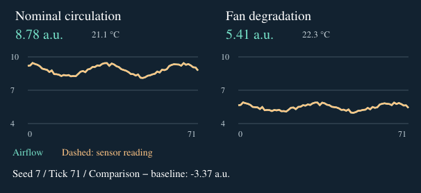

# Benedict Anokye-Davies

Computer Science with AI at Nottingham · Graduating June 2028 · Seeking summer 2027 internships in systems, backend engineering and applied AI.

I build software that helps people decide what happened and what to do next. That has meant recovering interrupted orders for a client, replaying faults in a habitat simulation and testing whether a robot policy has earned a rollout.

[Portfolio](https://b-davies.dev/) · [LinkedIn](https://www.linkedin.com/in/benedict-anokye-davies/)

### [AEOLUS](https://github.com/arm-hackathon/arm-hackathon) · How much airflow does a degraded fan lose?

I worked on simulation scenarios, recovery evidence and forecast evaluation for this team project. This deterministic browser fixture compares two scenarios with the same seed, clock and airflow scale. At tick 71, fan degradation reduces simulated airflow by **3.37 arbitrary units** for seed 7.

[Download the offline comparison GUI](https://raw.githubusercontent.com/bbeennyy860-cyber/bbeennyy860-cyber/main/demos/aeolus-fault-replay.html) · [Run the guided tour](https://github.com/arm-hackathon/arm-hackathon#start-here)

### [PolicyCanary](https://github.com/bbeennyy860-cyber/policycanary) · When has a robot policy earned a rollout?

I built a release gate that updates after each paired trial. I tested it on sign-flipped data where the two policies were equally effective by construction. Across 29 policy pairs, repeated fixed-sample testing produced a false promotion in 29.2% of runs. The sequential gate did so in 0.94%.

[Read the experiment](https://github.com/bbeennyy860-cyber/policycanary/blob/main/docs/CALIBRATION.md) · TypeScript, PostgreSQL, Python

### [Arbiter](https://github.com/bbeennyy860-cyber/arbiter) · Which invoices can an agent settle?

Alex Kurkar and I built this prototype for the Nous Research × NVIDIA × Stripe hackathon. I worked on the backend policy engine, agent core and ledger. Deterministic checks catch duplicate invoices and changed payee details before an approved payment reaches Stripe test mode.

[Follow a demo invoice](https://github.com/bbeennyy860-cyber/arbiter#example-demo-scenario) · Python, Stripe test mode

I’m also helping plan command and telemetry interfaces for Nottingham’s Vigil CubeSat team and studying VHDL for the proposed FPGA implementation.
