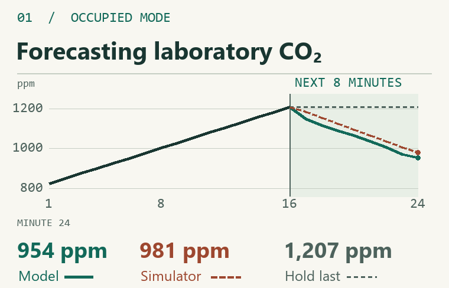
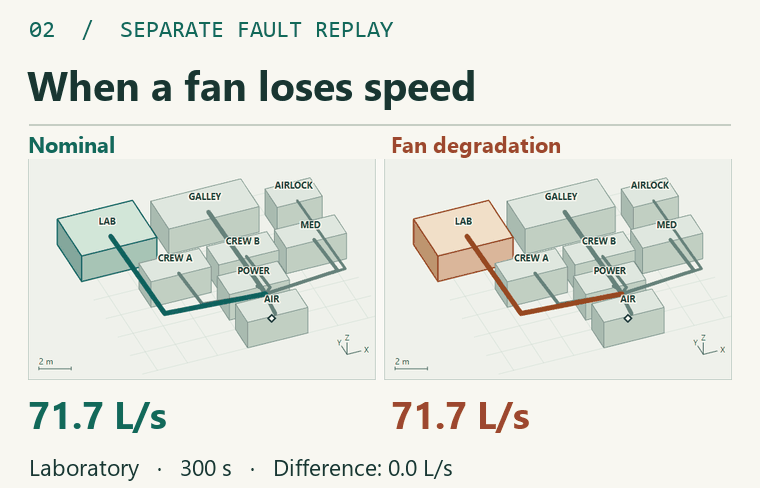

# Benedict Anokye-Davies

Computer Science with AI at Nottingham · Graduating June 2028 · Seeking summer 2027 internships in systems, backend engineering and applied AI.

I build software that helps people decide what happened and what to do next. That has meant recovering interrupted orders for a client, replaying faults in a habitat simulation and testing whether a robot policy has earned a rollout.

[Portfolio](https://b-davies.dev/) · [LinkedIn](https://www.linkedin.com/in/benedict-anokye-davies/)

### [AEOLUS](https://github.com/arm-hackathon/arm-hackathon) · Can a model forecast the air in a habitat?

  
  

Give the neural network the last 16 minutes of simulated sensor readings and it forecasts the next eight for four possible commands. In occupied mode it predicts **954 ppm** of laboratory CO₂; the simulator reaches **981 ppm**. In dormant mode, keeping the last reading beats the model. A separate 3D replay shows what happens when the fan receives the same command but delivers less air.

I worked on simulation scenarios, recovery evidence and forecast evaluation for this team project. The model advises; a deterministic controller decides which command the simulator applies.

[Download the offline demo](https://github.com/bbeennyy860-cyber/bbeennyy860-cyber/raw/96dcb4d0018b62667ff2655582a5ac0273714637/demos/aeolus-habitat-preview.zip) · [Explore both experiments](docs/aeolus/README.md) · [Run the model yourself](docs/aeolus/README.md#reproduce)

### [PolicyCanary](https://github.com/bbeennyy860-cyber/policycanary) · When has a robot policy earned a rollout?

I built a release gate that updates after each paired trial. I tested it on sign-flipped data where the two policies were equally effective by construction. Across 29 policy pairs, repeated fixed-sample testing produced a false promotion in 29.2% of runs. The sequential gate did so in 0.94%.

[Read the experiment](https://github.com/bbeennyy860-cyber/policycanary/blob/main/docs/CALIBRATION.md) · TypeScript, PostgreSQL, Python

### [Arbiter](https://github.com/bbeennyy860-cyber/arbiter) · Which invoices can an agent settle?

Alex Kurkar and I built this prototype for the Nous Research × NVIDIA × Stripe hackathon. I worked on the backend policy engine, agent core and ledger. Deterministic checks catch duplicate invoices and changed payee details before an approved payment reaches Stripe test mode.

[Follow a demo invoice](https://github.com/bbeennyy860-cyber/arbiter#example-demo-scenario) · Python, Stripe test mode

I’m also helping plan command and telemetry interfaces for Nottingham’s Vigil CubeSat team and studying VHDL for the proposed FPGA implementation.
