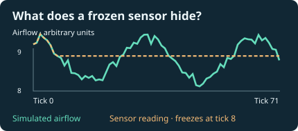
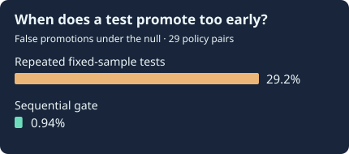
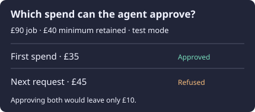

<h1 align="center">Benedict Anokye-Davies</h1>

Computer Science with AI at Nottingham · Systems, simulation and robotics Summer 2027 engineering internships · Graduating June 2028

<a href="https://b-davies.dev/">Portfolio</a> &nbsp;·&nbsp; <a href="https://www.linkedin.com/in/benedict-anokye-davies/">LinkedIn</a>

## Selected work

<table><tr>
<td width="50%" valign="top"> 
<b><a href="https://github.com/arm-hackathon/arm-hackathon">AEOLUS</a> · Habitat simulation</b>
On this team project I worked on fault scenarios, recovery evidence and forecast evaluation. This trace comes from the browser fixture, seed 7. The sensor freezes at tick 8 while the simulated airflow keeps changing.

<a href="https://github.com/arm-hackathon/arm-hackathon/tree/main/demo/browser-simulator">Reproduce the trace</a> · <code>Python</code> <code>NumPy</code></td>
<td width="50%" valign="top"> 
<b><a href="https://github.com/bbeennyy860-cyber/policycanary">PolicyCanary</a> · Robot policy evaluation</b>
I built a gate that decides when a new policy has earned a rollout. Across 29 sign-flipped policy pairs, repeated testing falsely promoted a candidate in 29.2% of runs. The sequential gate did so in 0.94%.

<a href="https://github.com/bbeennyy860-cyber/policycanary/blob/main/docs/CALIBRATION.md">Inspect the calibration</a> · <code>TypeScript</code> <code>PostgreSQL</code></td>
</tr><tr>
<td valign="top"> 
<b><a href="https://github.com/bbeennyy860-cyber/arbiter">Arbiter</a> · Governed payments</b>
Alex Kurkar and I built a payments agent for the Nous Research × NVIDIA × Stripe hackathon. I worked on the policy engine, agent core and ledger. The fixture above shows the same job passing one check and failing the next.
<a href="https://github.com/bbeennyy860-cyber/arbiter#example-demo-scenario">Follow the invoice</a> · <code>Python</code> <code>Stripe test mode</code></td>
<td valign="top"><h3>Vigil CubeSat</h3>
<b>In development · University of Nottingham</b>

How does a ground command reach the subsystem that must carry it out? My part of our student satellite project is defining these interfaces and developing C++ on-board data handling.

I’m studying VHDL for the team’s proposed FPGA implementation.
<code>C++</code> <code>Telemetry</code></td>
</tr></table>

