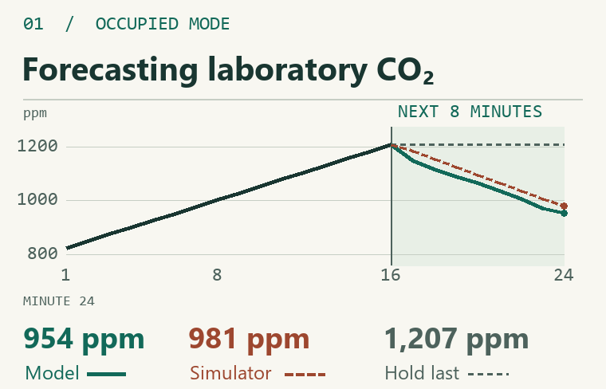
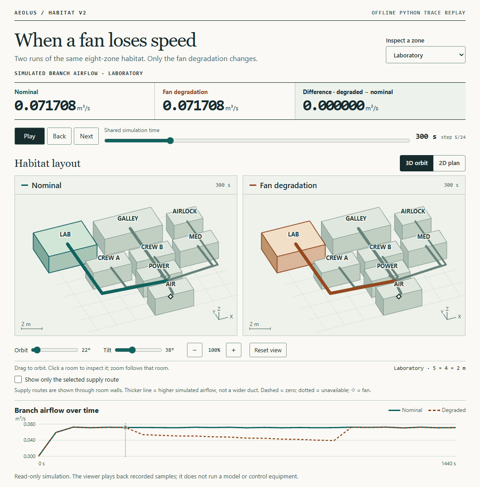

# AEOLUS · Inside the simulated habitat

[Download the offline demo (ZIP)](https://github.com/bbeennyy860-cyber/bbeennyy860-cyber/raw/96dcb4d0018b62667ff2655582a5ac0273714637/demos/aeolus-habitat-preview.zip) · [Team repository](https://github.com/arm-hackathon/arm-hackathon) · [Reproduce](#reproduce)

Unzip the download and open **`index.html`**. No installation or internet connection is needed to explore the two recorded experiments. GitHub shows the previews; it does not run the model in your browser.

## Forecast

At minute 16, the laboratory CO₂ reading is **1,207 ppm**. If the operator proposes occupied mode, where will it be eight minutes later?

[](../../assets/aeolus-forecast.png)

Select **Occupied → Show saved forecast**. The trained neural network used the same 16 one-minute observations to forecast 51 quantities under each of four candidate commands. Those are four predictions, not four measured futures. The operator selects a command; only the deterministic Habitat Management Controller can apply it in the simulation.

Select **Reveal simulator outcome**. Over the next eight minutes, the model’s mean absolute error for lab CO₂ is **32.3 ppm**; a baseline that keeps the minute-16 reading fixed misses by **126.3 ppm**. Now try **Dormant**: the baseline wins, **21.7 ppm** against the model’s **40.8 ppm**. Each comparison uses the simulated future for that same command. One development scenario is not an accuracy benchmark.

## Fan replay

[](https://github.com/bbeennyy860-cyber/bbeennyy860-cyber/raw/96dcb4d0018b62667ff2655582a5ac0273714637/demos/aeolus-habitat-preview.zip)

Open **3D airflow replay**. The two runs use the same eight rooms, loads and fan commands; only one has a fan fault. At **300 s**, both report **71.708 L/s** to the lab. Step forward to **360 s**: nominal flow is **71.788 L/s** and degraded flow is **53.891 L/s**, a loss of **17.898 L/s** using the unrounded samples. Drag to orbit, or select a room to inspect its supply route.

This is the Python simulator’s recorded airflow, not equipment telemetry. Route thickness represents airflow, not duct diameter. The forecast experiment above has **no fan fault**: the model did not diagnose this one.

## Reproduce

The [team’s simulator](https://github.com/arm-hackathon/arm-hackathon/tree/c74c15592d60f36282f33a103ae0dbe7540a7a3a) and [model runner](https://github.com/arm-hackathon/arm-hackathon/blob/c74c15592d60f36282f33a103ae0dbe7540a7a3a/scripts/run_habitat_v2_mlp_forecast.py) are pinned to the revision used for these examples. With Git and [uv](https://docs.astral.sh/uv/) installed, this runs **fresh inference in Python**:

```sh
git clone https://github.com/arm-hackathon/arm-hackathon.git aeolus
cd aeolus
git switch --detach c74c15592d60f36282f33a103ae0dbe7540a7a3a
uv sync --locked --python 3.11 --extra dev
uv run --locked --python 3.11 --extra dev python scripts/run_habitat_v2_mlp_forecast.py --selected-action normal-occupied-v1 --json
```

Compare `run.trace_sha256` with `records["normal-occupied-v1"].traceSha` in the download’s `cases.json`. Try `normal-dormant-v1` for the baseline counterexample. For the separate airflow comparison, `READ-ME.txt` gives the two plant commands using the supplied scenario inputs. The ZIP includes the upstream MIT licence.

AEOLUS is a team project. My work included simulation scenarios, recovery evidence and forecast evaluation. This is a portfolio demonstration of simulated behaviour, not a team software release or a hardware validation claim.
